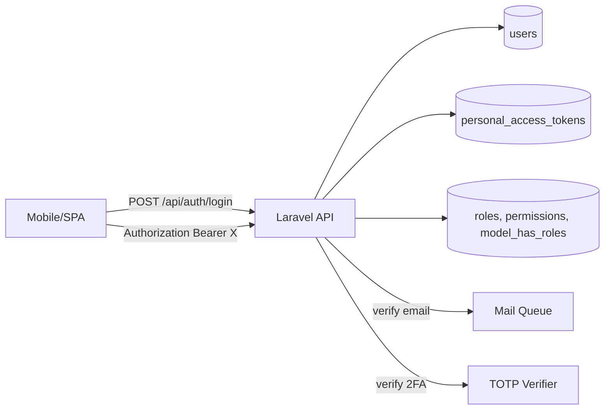

# Auth Starter — Laravel 11 + Sanctum + RBAC + 2FA

A production-ready authentication boilerplate for any Laravel API project. Fork it, run `docker compose up`, and start building your business logic on day one.

## What this demonstrates

- **Sanctum** bearer-token API authentication (works for SPAs and mobile)
- **Spatie roles & permissions** (RBAC) with `admin`, `manager`, `user` defaults
- **Email verification** via signed URLs
- **Password reset** flow with token + cool-down
- **TOTP 2FA** (Google Authenticator compatible) with recovery codes
- **Login throttling** + per-user device sessions
- **Refresh tokens** with rotation
- **Tests** with Pest (auth flow + permission policies)
- **Dockerized** — `docker compose up` and authenticate against `localhost:8000`

## Architecture



## Tech stack

- Laravel 11, PHP 8.3
- Laravel Sanctum (bearer tokens)
- Spatie Laravel Permission (RBAC)
- pragmarx/google2fa-laravel (TOTP)
- MySQL 8 + Redis 7
- Pest 3

## Quick start

```bash
cp .env.example .env
docker compose up -d
docker compose exec app composer install
docker compose exec app php artisan key:generate
docker compose exec app php artisan migrate --seed
```

Default seeded users:
- admin@example.com / password (role: admin)
- user@example.com / password (role: user)

## API reference

| Method | Path                          | Description                            |
|--------|-------------------------------|----------------------------------------|
| POST   | `/api/auth/register`          | Register + send verification email     |
| POST   | `/api/auth/login`             | Login (returns Sanctum token)          |
| POST   | `/api/auth/logout`            | Revoke current token                   |
| GET    | `/api/auth/me`                | Current user + roles                   |
| POST   | `/api/auth/email/verify/{id}` | Verify email via signed URL            |
| POST   | `/api/auth/password/forgot`   | Send reset link                        |
| POST   | `/api/auth/password/reset`    | Reset with token                       |
| POST   | `/api/auth/2fa/enable`        | Generate QR + secret                   |
| POST   | `/api/auth/2fa/confirm`       | Confirm with TOTP code                 |
| POST   | `/api/auth/2fa/disable`       | Disable 2FA                            |
| GET    | `/api/admin/users`            | List users (requires `users.view`)     |

## Permission map (default)

| Role    | Permissions                                  |
|---------|----------------------------------------------|
| admin   | users.*, roles.*, settings.*                 |
| manager | users.view, users.update                     |
| user    | profile.update                               |

## Tests

```bash
docker compose exec app ./vendor/bin/pest
```

## Roadmap / known limitations

- Mailer is `log` driver in dev — wire up Mailgun/Resend in production
- No social login yet (Google/GitHub coming via Socialite)
- Refresh-token rotation requires explicit `/refresh` call; consider sliding expiration

## Deploy

See [DEPLOY.md](DEPLOY.md).

<!-- ownership:author -->
---

## Author

**Umair** &mdash; [@umairjutt](https://github.com/umairjutt)

Designed, built and maintained by me. Licensed under the [MIT License](LICENSE).